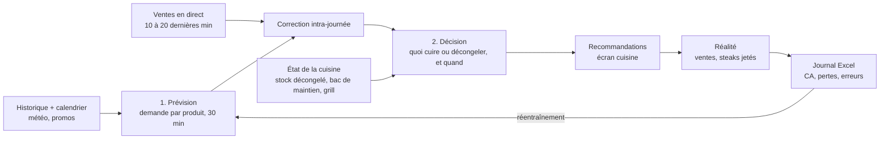
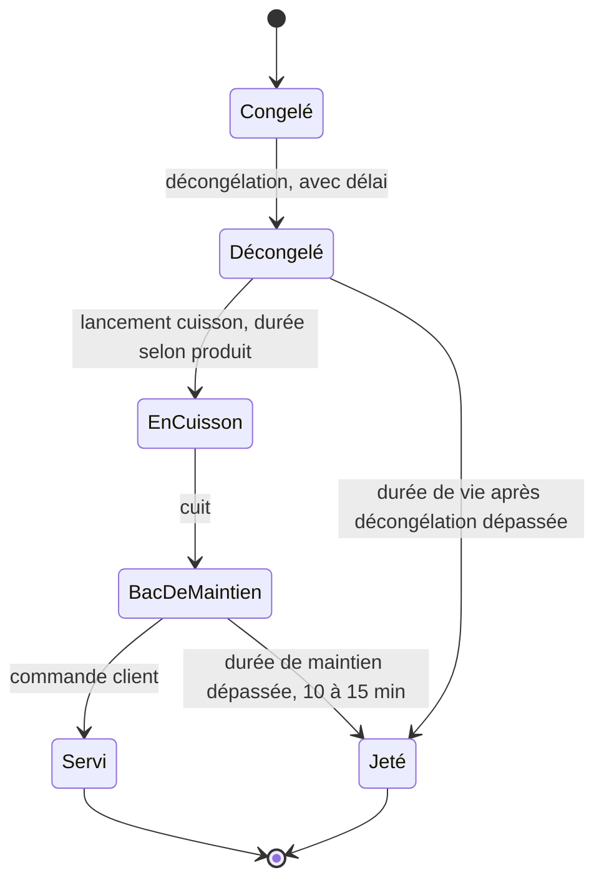
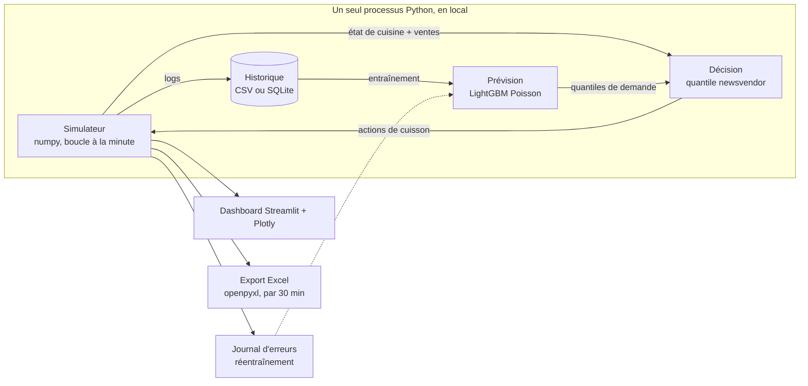
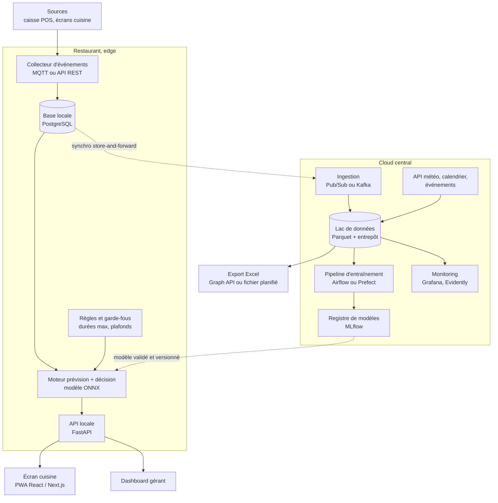
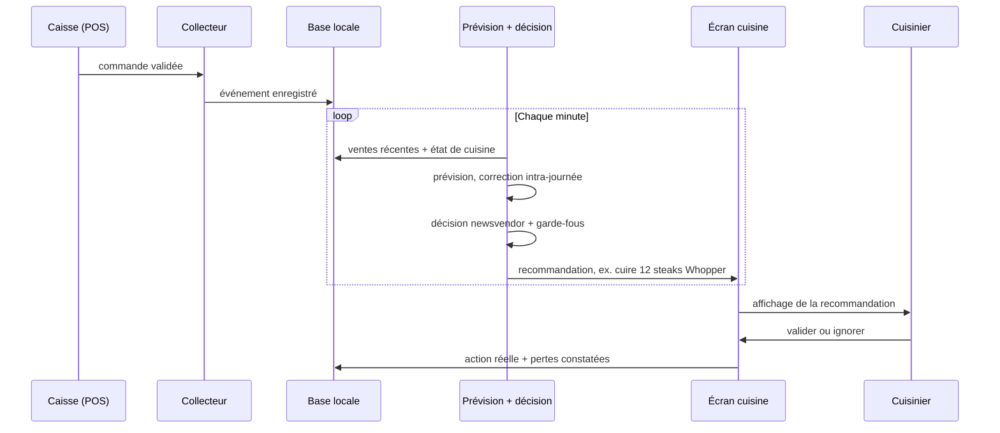
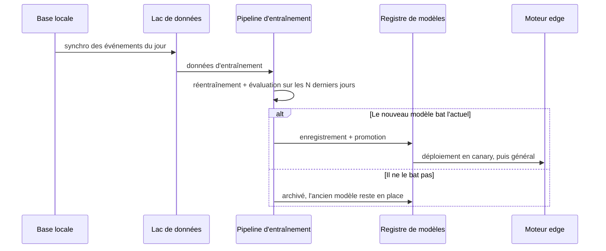

# Agent anti-gaspillage pour la restauration rapide

> Prévision de la demande et gestion des stocks de viande en temps réel, pour réduire les steaks jetés et le temps d'attente des clients.

Ce document décrit le projet, les modèles retenus et **deux architectures** :

1. **Architecture 1, démo locale** : prototype à implémenter en 1,5 jour, tout en Python, sur une seule machine.
2. **Architecture 2, version entreprise** : déploiement hybride (dans le restaurant + cloud), pensé pour la production.

> Les schémas sont écrits en [Mermaid](https://mermaid.js.org/). Ils s'affichent automatiquement sur GitHub et GitLab, et dans VS Code avec l'extension *Markdown Preview Mermaid Support*.

---

## Sommaire

1. [Contexte et problème](#1-contexte-et-problème)
2. [Vue d'ensemble en un coup d'œil](#2-vue-densemble-en-un-coup-dœil)
3. [Principe de l'agent](#3-principe-de-lagent)
4. [Modèles](#4-modèles)
5. [Simulation](#5-simulation)
6. [Données](#6-données)
7. [Architecture 1 : démo locale](#7-architecture-1--démo-locale-15-jour)
8. [Architecture 2 : version entreprise](#8-architecture-2--version-entreprise-hybride-local--distant)
9. [Comparaison des deux architectures](#9-comparaison-des-deux-architectures)
10. [Évaluation et KPI](#10-évaluation-et-kpi)
11. [Risques, hypothèses et questions ouvertes](#11-risques-hypothèses-et-questions-ouvertes)
12. [Glossaire](#12-glossaire)

---

## 1. Contexte et problème

Dans une chaîne de restauration rapide (type Burger King), trois types de viande sont préparés : **Hamb**, **Whopper** et **Master**. Chacun a un **temps de cuisson différent**, selon le type de grill (broiler).

Le problème est double :

| Situation | Conséquence |
|---|---|
| On cuit **trop** de steaks | Un steak cuit se garde **10 à 15 min** dans le bac de maintien, puis il est **jeté** : perte de matière première. |
| On cuit **trop peu** de steaks | Les clients **attendent**. Et on ne peut pas utiliser un produit congelé directement : il faut le **décongeler** à l'avance. |

**Exemple de perte.** Sur une fenêtre de 15 min, 5 burgers sont commandés avec 2 steaks chacun, donc 10 steaks utilisés. Si un lot contient 15 steaks, **5 steaks sont perdus**. L'agent doit calculer cette perte potentielle en continu, pendant tout le service.

### Objectifs

- Réduire le **gaspillage** de viande (steaks jetés / steaks cuits).
- Réduire le **temps d'attente** client et les ruptures.
- Fournir au gérant un **suivi par tranche de 30 min** (chiffre d'affaires, pertes potentielles, erreurs de prévision), exporté vers **Excel**, l'outil déjà utilisé en restaurant.
- **S'améliorer avec le temps** en apprenant de ses erreurs de prévision.

---

## 2. Vue d'ensemble en un coup d'œil

```text
ARCHITECTURE 1 : DÉMO LOCALE (1,5 jour)           ARCHITECTURE 2 : ENTREPRISE (hybride)

  1 machine, 1 processus Python                   Restaurant (edge)         Cloud central
  ┌─────────────────────────────┐                 ┌──────────────────┐      ┌──────────────────┐
  │ Simulateur ⇄ Décision       │                 │ Collecteur       │      │ Lac de données   │
  │      ↓            ↑         │                 │ Base locale      │─────▶│ Entraînement     │
  │ Historique → Prévision      │                 │ Prévision+Décision◀─────│ Registre modèles │
  └─────────────┬───────────────┘                 │ API locale       │      │ Monitoring       │
                ↓                                 └────────┬─────────┘      └──────────────────┘
   Streamlit · Export Excel · Journal d'erreurs            ↓
                                                   Écran cuisine · Dashboard gérant · Excel
```

---

## 3. Principe de l'agent

L'agent n'est pas un simple modèle de prédiction. Il résout **deux problèmes distincts** :

1. **Prévoir** : combien de steaks de chaque type seront nécessaires dans les prochaines 30 min ? C'est de la prévision de **comptage** avec **incertitude**.
2. **Décider** : combien en cuire, et quand, sachant que cuire trop coûte une perte et cuire trop peu coûte de l'attente ? C'est un problème de **décision sous incertitude** (type *newsvendor* avec produit périssable).



### Cycle de vie d'un steak

C'est ce cycle que le simulateur reproduit et que l'agent optimise.



---

## 4. Modèles

### 4.1 Pourquoi pas une régression linéaire ?

- La demande est un **comptage** (entier, non négatif) avec des pics.
- Les effets sont **non linéaires et croisés** : jeudi × soir × période étudiante × jour férié.
- On a besoin d'une **distribution** (quantiles), pas seulement d'une moyenne : la décision dépend du risque.

### 4.2 Modèle de prévision

| | Démo | Entreprise |
|---|---|---|
| Modèle principal | **LightGBM** (ou `HistGradientBoostingRegressor`) avec perte de **Poisson** | LightGBM en baseline, comparé à des modèles probabilistes : **Temporal Fusion Transformer**, **DeepAR**, **N-HiTS** (Darts, GluonTS ou Nixtla) |
| Incertitude | Quantiles issus d'une loi de Poisson ou binomiale négative (`scipy.stats`) | Quantiles appris + **conformal prediction** pour des intervalles calibrés |
| Portée | Un modèle par produit | Modèle **global** multi-restaurants, hiérarchie restaurant → produit |
| Baseline de comparaison | Moyenne du même créneau | Idem, plus le modèle de la version précédente |

**Features principales**

- Créneau de 30 min, jour de la semaine, mois.
- Jour férié, veille de férié, vacances scolaires.
- Soirée étudiante (jeudi, vendredi ou autre), événements locaux.
- Ventes du **même créneau la semaine passée** et **l'an dernier**.
- Météo et promotions (si disponibles).
- Ratio **ventes réelles / prévues** sur les dernières minutes (voir 4.3).

**De commandes à steaks.** On prévoit les commandes par produit, puis on convertit en steaks avec une table de recette (nombre de steaks par Hamb, Whopper, Master), à configurer dans `config.py`.

### 4.3 Correction intra-journée (« tendance »)

On compare les ventes réelles des 10 à 20 dernières minutes à ce que le modèle avait prévu :

```text
k  = clip( (réel[t-20..t] + a) / (prévu[t-20..t] + a),  k_min,  k_max )
μ' = k × μ                       # prévision corrigée pour les 30 min suivantes
```

- `a` est un lissage (évite les divisions par de petits nombres).
- Si la tendance récente est faible, on garde la prévision de base (« ça reste calme »).
- **En heure de pointe** (typiquement midi–15h et 21h–22h30, à calibrer sur les données), on **relève le plancher** `k_min` : on s'attend à plus de demande que dans les heures calmes.
- Version plus rigoureuse : mise à jour bayésienne **Gamma-Poisson**.

### 4.4 Politique de décision (newsvendor)

Pour chaque produit et chaque lot, on cuit la quantité `q` égale au **quantile τ** de la demande sur la fenêtre de maintien :

```text
τ  = Cu / (Cu + Co)
q* = F⁻¹(τ)                      # F = distribution de la demande sur la fenêtre de maintien
perte_attendue = E[ max(q - D, 0) ]

Cu = coût d'une rupture ou d'une attente client
Co = coût d'un steak jeté
```

- **Délai de cuisson** : on lance la cuisson à `t_besoin - durée_cuisson(produit)`.
- **Décongélation** : un **plan du matin** (quantile de la demande journalière par bloc horaire), puis des **ajustements** pendant la journée. L'horizon étant plus long, l'incertitude est plus grande : le quantile est plus prudent.
- **Perte réalisée** par lot : `max(cuits - utilisés avant péremption, 0)`.

> Le **RL** (PPO sur le simulateur) n'est envisagé qu'en version avancée, et seulement s'il bat cette politique.

### 4.5 Apprentissage par l'erreur

Chaque jour : calcul de l'écart prévu / réel, journalisation, **réentraînement nocturne**. Un nouveau modèle n'est **promu** que s'il bat l'actuel sur les N derniers jours.

---

## 5. Simulation

Une **simulation à événements discrets** reproduit une journée de service. Elle sert à trois choses :

1. **Générer des données synthétiques** (nous n'avons pas de vraies données).
2. **Comparer des politiques** sur exactement les mêmes journées : règle fixe du manager vs agent.
3. **Faire tourner la démo en direct.**

### Éléments simulés

| Élément | Modélisation |
|---|---|
| Arrivées de clients | Processus de Poisson **non homogène** : taux dépendant du créneau, du jour, du férié, de la soirée étudiante |
| Commandes | Composition en Hamb / Whopper / Master, avec un nombre de steaks par produit |
| Grill | Capacité limitée et **temps de cuisson par produit** |
| Bac de maintien | Péremption des steaks après 10 à 15 min (paramètre) |
| Stock | Congelé → décongelé, avec un délai de décongélation |
| Client | Temps d'attente, abandon éventuel si l'attente est trop longue |

**Outils.** Démo : boucle **à la minute** en `numpy` (plus rapide à écrire). Entreprise : **SimPy** + **Gymnasium** si on explore le RL.

> **À dire clairement lors de la présentation.** Avec des données synthétiques, on démontre que le **pipeline fonctionne**, pas que le modèle est précis dans un vrai restaurant. En entreprise, on valide d'abord en **mode shadow** (voir section 8).

---

## 6. Données

### Table de base (une ligne par produit et par tranche de 30 min)

| Colonne | Description |
|---|---|
| `periode_30min` | Horodatage de début de tranche |
| `produit` | Hamb, Whopper ou Master |
| `commandes` | Nombre de produits vendus |
| `steaks_utilises` | Steaks réellement consommés |
| `steaks_cuits` | Steaks cuits dans la tranche |
| `steaks_jetes` | Steaks jetés (péremption) |
| `stock_decongele` | Stock décongelé en début de tranche |
| `ca` | Chiffre d'affaires de la tranche |

Données complémentaires : calendrier (fériés, vacances, soirées), météo, promotions.
Historique minimal visé : **1 an** (saisonnalité). La démo génère **12 à 24 mois**.

### Journal Excel (une ligne par tranche de 30 min)

| Colonne | Description |
|---|---|
| `periode_30min` | Tranche horaire |
| `ca` | Chiffre d'affaires |
| `prevision_mu` | Prévision moyenne |
| `q10`, `q50`, `q90` | Quantiles de prévision |
| `reel` | Demande réelle |
| `erreur` | Écart prévu / réel |
| `perte_potentielle` | Perte attendue calculée par l'agent |
| `perte_reelle` | Steaks réellement jetés |

---

## 7. Architecture 1 : démo locale (1,5 jour)

### Objectif

Montrer, sur un ordinateur, une journée de service simulée où l'agent **bat une politique fixe** en gaspillage et en attente. Tout en **Python**, sans Docker, sans API, sans backend séparé.

### Schéma



### Stack technique

| Couche | Choix |
|---|---|
| Langage | Python 3.11 |
| Données | `pandas`, `numpy`, CSV ou SQLite |
| Prévision | `lightgbm` (perte Poisson), `scipy.stats` pour les quantiles |
| Décision | Fonction newsvendor maison (quelques dizaines de lignes) |
| Simulation | Boucle à la minute en `numpy` |
| Interface | `streamlit` + `plotly` |
| Excel | `openpyxl` |
| Environnement | `venv` ou `uv`, lancement par `streamlit run app.py` |

### Structure du dépôt

```text
fastfood-waste-agent/
├── README.md
├── requirements.txt
├── app.py                      # interface Streamlit
├── src/
│   ├── config.py               # durées de maintien et de cuisson, coûts Cu/Co, steaks par produit
│   ├── data/
│   │   └── generate.py         # générateur de données synthétiques
│   ├── simulator/
│   │   ├── demand.py           # arrivées et composition des commandes
│   │   ├── kitchen.py          # grill, bac de maintien, stock décongelé
│   │   └── engine.py           # boucle de simulation
│   ├── forecast/
│   │   ├── features.py
│   │   ├── model.py            # LightGBM + quantiles
│   │   ├── intraday.py         # correction de tendance
│   │   └── baseline.py         # moyenne du même créneau
│   ├── policy/
│   │   ├── newsvendor.py       # politique de l'agent
│   │   └── fixed_rule.py       # politique « manager » de comparaison
│   ├── evaluation/
│   │   └── metrics.py          # WAPE, biais, pinball, gaspillage, attente
│   └── export/
│       └── excel.py
├── data/                       # CSV générés
└── tests/
```

### Contrats entre modules (à figer en premier)

Pour que l'équipe travaille en parallèle sans se bloquer, on fixe ces signatures **avant** de coder :

```python
def forecast(features: pd.DataFrame) -> pd.DataFrame:
    """Colonnes retournées : product, mu, q10, q50, q90."""

def decide(state: KitchenState, fc: pd.DataFrame, t: datetime) -> list[Action]:
    """Actions : cuire N steaks du produit P, ou décongeler M steaks."""

def simulate_day(day: date, policy: Callable, seed: int) -> SimLogs:
    """Rejoue une journée avec une politique et retourne les logs."""
```

### Écrans de la démo

| Écran | Contenu |
|---|---|
| Journée en direct | Rejeu d'une journée avec curseur de vitesse, steaks en cuisson, en bac, jetés |
| Prévu vs réel | Courbes par produit et par tranche de 30 min, avec intervalle q10–q90 |
| Comparaison | Même journée avec la politique fixe vs l'agent : % de gaspillage, attente moyenne et P90, ruptures |
| Export | Bouton de génération du fichier Excel (tranches de 30 min) |

### Planning sur 1,5 jour (équipe de 4)

| Moment | Personne A | Personne B | Personne C | Personne D |
|---|---|---|---|---|
| **J1 début** (30 min) | Tout le monde : figer `config.py`, le schéma de données et les contrats | | | |
| **J1 matin** | Générateur de données + simulateur | Squelette Streamlit (écrans vides) | Features + baseline naïve | Politique fixe + métriques |
| **J1 après-midi** | Simulateur : bac de maintien, péremption, attente | Graphiques Plotly branchés sur des données factices | LightGBM + quantiles | Politique newsvendor |
| **J2 matin** | Intégration : brancher modèle et politique dans le simulateur | Écrans « en direct » et « comparaison » | Correction intra-journée | Export Excel |
| **J2 dernière heure** | Répétition de la démo, correction des bugs. **Aucune nouvelle fonctionnalité.** | | | |

### Scénario de démo conseillé

1. Choisir un **jeudi soir en période étudiante** ou un **jour férié**, là où l'écart entre politique fixe et agent est le plus visible.
2. Rejouer la journée avec la **politique fixe** : montrer le compteur de steaks jetés et l'attente.
3. Rejouer la **même journée** avec l'**agent** : montrer la baisse du gaspillage et de l'attente.
4. Montrer l'écran **prévu vs réel**, puis l'**export Excel** généré.

### Critères de réussite de la démo

- [ ] Le simulateur rejoue une journée complète avec les trois produits.
- [ ] Le modèle LightGBM bat la baseline « moyenne du même créneau » (WAPE plus faible).
- [ ] L'agent réduit le gaspillage **et** l'attente par rapport à la politique fixe sur plusieurs journées simulées.
- [ ] L'export Excel contient une ligne par tranche de 30 min avec CA, prévision et pertes.
- [ ] Un `README` de lancement : une commande pour tout démarrer.

### Hors périmètre de la démo

Docker, API REST, vraie caisse, authentification, déploiement distant, réentraînement automatique planifié, RL.

---

## 8. Architecture 2 : version entreprise (hybride local + distant)

### Principe

La cuisine ne peut pas dépendre d'internet. La **décision tourne donc dans le restaurant** (edge). Le **cloud** sert à entraîner les modèles, agréger plusieurs restaurants et superviser.

### Schéma d'ensemble



### Cycle de décision dans le restaurant (toutes les minutes)



### Cycle d'apprentissage (chaque nuit)



### Composants

| Composant | Rôle | Technologies proposées | Alternatives |
|---|---|---|---|
| Collecteur | Reçoit les événements de caisse et de cuisine | MQTT, API REST | Connecteur propre à la caisse (**à valider avec l'entreprise**) |
| Base locale | Historique récent, fonctionne hors ligne | PostgreSQL | SQLite pour un très petit site |
| Moteur de décision | Prévision + décision toutes les minutes | Python, modèle exporté en **ONNX** | Appel d'un service cloud (déconseillé : dépend du réseau) |
| Garde-fous | Contraintes de sécurité alimentaire | Règles codées en dur | |
| API locale | Expose les recommandations | FastAPI, WebSocket | |
| Écran cuisine | Affiche et valide les recommandations | React / Next.js (PWA) | Application tablette native |
| Dashboard gérant | Suivi CA, pertes, erreurs | React ou Grafana | Metabase |
| Ingestion cloud | Reçoit les événements des restaurants | Pub/Sub, Kafka ou Redpanda | |
| Lac de données | Stockage historique | Parquet sur GCS + BigQuery ou TimescaleDB | S3 + Athena |
| Orchestration | Pipelines d'entraînement | Airflow, Prefect ou Dagster | |
| Registre de modèles | Versions, promotion, retour arrière | MLflow | Vertex AI Model Registry |
| Monitoring | Santé du système et dérive des données | Prometheus, Grafana, Evidently | |
| Authentification | Accès par rôle et par restaurant | OIDC (Keycloak) | |
| Infrastructure | Déploiement reproductible | Docker Compose ou **K3s** sur edge, Terraform, GitHub Actions | |

### Modes de déploiement

| Mode | Description | Verdict |
|---|---|---|
| Tout local | Chaque restaurant autonome, sans cloud | Pas d'apprentissage global, supervision difficile |
| Tout distant | Décision dans le cloud | Dépend d'internet en cuisine, risque en cas de coupure |
| **Hybride (retenu)** | Décision en edge, entraînement et supervision dans le cloud | Autonomie en cuisine + amélioration continue |

### Fiabilité et mode dégradé

| Panne | Comportement |
|---|---|
| Cloud injoignable | L'edge continue seul ; les événements sont **mis en file** et envoyés plus tard (store-and-forward, envoi **idempotent**) |
| Modèle indisponible ou incohérent | Bascule sur des **règles fixes** (politique de secours) |
| Caisse déconnectée | Alerte, et recommandations basées sur l'historique seul |
| Mise à jour de modèle ratée | **Retour arrière** vers la version précédente (registre) |

### Garde-fous et sécurité alimentaire

- Les **durées maximales de maintien** et de vie après décongélation sont **codées en dur** (selon la procédure interne). Le modèle ne les décide **jamais**.
- Chaque recommandation reste **validée par un humain** (valider / ignorer), au moins en phases 1 à 3.
- Plafonds de sécurité sur les quantités recommandées.
- Les recommandations ignorées sont journalisées : elles servent à améliorer le modèle.

### Sécurité et conformité

- Chiffrement des échanges (TLS), secrets dans un coffre (Secret Manager ou Vault).
- Accès par rôle (cuisinier, gérant, administrateur) et par restaurant.
- Les commandes sont **anonymes** : pas de données personnelles de clients nécessaires.

### Mise en production progressive

| Phase | Description | Critère de passage |
|---|---|---|
| 0. Audit de données | Récupérer les exports de caisse, vérifier la qualité | Historique exploitable sur au moins 12 mois |
| 1. **Shadow** | L'agent recommande sans rien changer ; on compare au réel | Prévision meilleure que la baseline, pertes évitables estimées |
| 2. Assisté | Recommandations affichées en cuisine, le cuisinier décide | Adoption par les équipes, gaspillage en baisse |
| 3. Canary | Quelques restaurants pilotes, groupe témoin à côté | Baisse du gaspillage mesurée sur le pilote vs témoin |
| 4. Déploiement | Extension multi-restaurants, modèle global | Supervision et réentraînement stables |

### Intégration Excel

- **Option A** : écriture directe dans le classeur existant via **Microsoft Graph API** ou **Power Automate**.
- **Option B (repli)** : export XLSX planifié (une ligne par tranche de 30 min, colonnes de la section 6).

### Observabilité et qualité des modèles

| Mesure | Utilité |
|---|---|
| WAPE, biais | Précision de la prévision |
| Pinball loss, couverture des intervalles | Qualité des quantiles |
| Taux de gaspillage, attente moyenne et P90 | Impact métier |
| Dérive des données (Evidently) | Détecter un changement de comportement client |
| Latence d'inférence | Réactivité du moteur en cuisine |

### Option : LLM

Un LLM peut **expliquer en langage naturel** une recommandation (« jeudi soir étudiant, +20 % attendu »). Il ne doit **pas** être dans le chemin critique de la décision.

---

## 9. Comparaison des deux architectures

| Critère | Architecture 1 : démo | Architecture 2 : entreprise |
|---|---|---|
| Objectif | Convaincre en démo | Fonctionner en production |
| Durée de mise en œuvre | **1,5 jour** | Plusieurs semaines à mois, par phases |
| Données | Synthétiques | Réelles (caisse, météo, calendrier) |
| Déploiement | Un ordinateur | Edge (restaurant) + cloud |
| Modèle de prévision | LightGBM Poisson | LightGBM + modèles probabilistes, conformal |
| Décision | Newsvendor | Newsvendor + garde-fous (RL en option) |
| Stockage | CSV ou SQLite | PostgreSQL local + lac de données |
| Interface | Streamlit | PWA cuisine + dashboard gérant |
| Excel | Export `openpyxl` | Graph API ou export planifié |
| Apprentissage | Réentraînement manuel | Pipeline nocturne, promotion automatique contrôlée |
| Panne réseau | Sans objet | Edge autonome + mode dégradé |
| Supervision | Aucune | Prometheus, Grafana, Evidently |
| Sécurité | Aucune | OIDC, TLS, rôles |

**Évolution.** Le code de la démo (prévision, politique, métriques) est conçu pour être **réutilisé** dans l'architecture 2 : mêmes contrats `forecast`, `decide` et `simulate_day`. Le simulateur devient alors le **banc d'essai** des nouveaux modèles avant déploiement.

---

## 10. Évaluation et KPI

| KPI | Définition |
|---|---|
| Taux de gaspillage | `steaks_jetés / steaks_cuits` |
| Attente moyenne et P90 | Temps entre la commande et le service |
| Taux de rupture | Part des commandes retardées faute de steaks prêts |
| WAPE | `Σ|réel - prévu| / Σ réel` |
| Biais | `Σ(prévu - réel) / Σ réel` |
| Pinball loss | Qualité des quantiles q10, q50, q90 |
| Couverture | Part des observations réellement dans [q10, q90] (cible proche de 80 %) |

**Protocole de comparaison.** On rejoue **les mêmes journées** (mêmes graines aléatoires) avec la politique fixe et avec l'agent, sur plusieurs dizaines de journées, y compris des cas difficiles (jour férié, soirée étudiante, jour calme).

---

## 11. Risques, hypothèses et questions ouvertes

### Hypothèses de la démo

- Durée de maintien : **10 à 15 min** (paramètre `hold_max`).
- Les temps de cuisson, le nombre de steaks par produit et les coûts `Cu` / `Co` sont des **paramètres à fixer** dans `config.py`.
- Les données sont synthétiques : les résultats prouvent le fonctionnement du pipeline, pas la précision réelle.

### Risques

| Risque | Mitigation |
|---|---|
| Données réelles de mauvaise qualité | Phase 0 d'audit, nettoyage, règles de validation |
| Modèle qui dérive (nouveau menu, promotion, travaux) | Monitoring de dérive, réentraînement, retour arrière |
| Rejet par les équipes | Recommandations explicables, validation humaine, phase assistée |
| Sur-ajustement à la démo | Évaluer sur des journées simulées jamais vues pendant l'entraînement |
| Dépendance à la connexion | Edge autonome et mode dégradé |

### Questions à clarifier avec l'entreprise

- Quelle caisse (POS) et quels exports ou API sont disponibles ?
- Durées officielles de maintien et de vie après décongélation, par produit ?
- Nombre de steaks par produit (recettes) et temps de cuisson par type de grill ?
- Coût d'un steak jeté et coût d'une attente (ou objectif de temps de service) ?
- Existe-t-il un historique de ventes sur 12 mois ou plus, au pas de 30 min ou mieux ?
- Quel outil Excel exact est utilisé, et sous quel format (classeur partagé, modèle fixe) ?
- Contraintes de sécurité réseau dans les restaurants (ports, VPN) ?

---

## 12. Glossaire

| Terme | Sens |
|---|---|
| Edge | Matériel installé dans le restaurant, qui exécute la décision localement |
| Newsvendor | Modèle classique de décision de stock avec coûts asymétriques (trop / pas assez) |
| Quantile τ | Valeur de demande dépassée avec une probabilité 1 - τ |
| WAPE | Erreur absolue pondérée, en pourcentage de la demande |
| Pinball loss | Fonction de perte pour évaluer des quantiles prédits |
| Conformal prediction | Méthode pour obtenir des intervalles de prévision calibrés |
| Shadow mode | L'agent recommande sans agir, pour comparer au réel |
| Canary | Déploiement sur quelques sites avant généralisation |
| Store-and-forward | Mise en file locale des données, envoyées quand le réseau revient |
| ONNX | Format portable pour exécuter un modèle sans dépendre de l'outil d'entraînement |
| Heures de pointe | Périodes de forte affluence (midi–15h et 21h–22h30, à confirmer par les données) |
